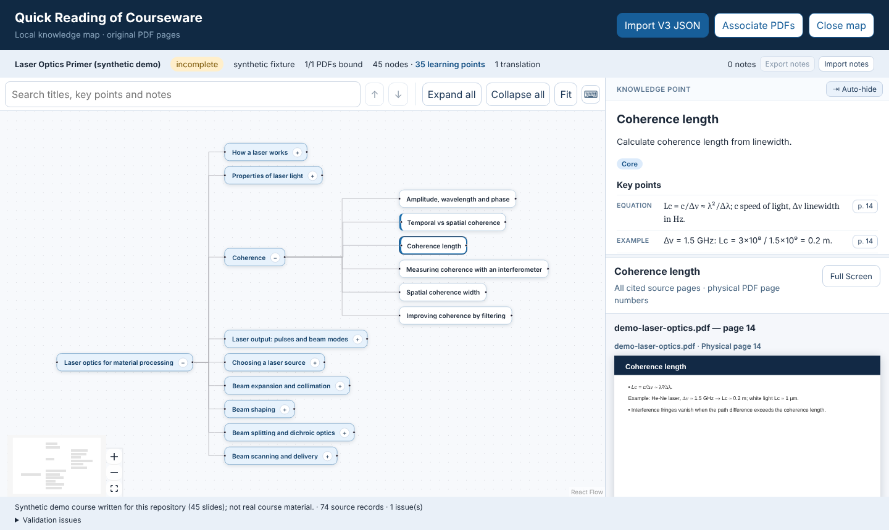
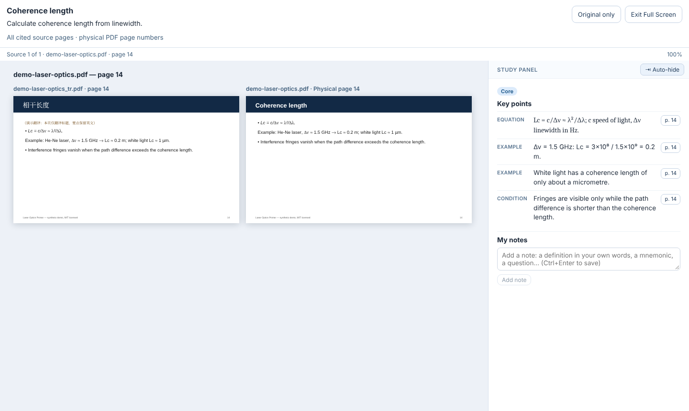

# Quick Reading of Courseware

Turn lecture PDFs into a **source-linked learning mind map**, then study it in a local viewer next to the original slides.

The project has two parts:

| Part | What it does | Where |
|---|---|---|
| **Decomposition skill** | Instructions + scripts that let an AI assistant (Claude or ChatGPT) read course PDFs and produce a validated `qr-courseware-map` JSON: a concept-ordered tree of learning points, each with key points, an importance label and exact page citations. | [`skill/quick-reading-courseware-decomposition`](skill/quick-reading-courseware-decomposition) |
| **Viewer** | A local React app that opens the JSON with the original PDFs: mind map, key points, notes, search, full-screen reading and optional side-by-side translations. Runs entirely in your browser; nothing is uploaded. | this folder (`src/`) |




*Screenshots use the synthetic demo course in [`fixtures/`](fixtures) (written for this repository).*

---

## Quick start (viewer)

Requirements: [Node.js](https://nodejs.org/) 22.13 or newer.

```bash
git clone https://github.com/X14-rn/quick-reading-courseware.git
cd quick-reading-courseware
npm install
npm run dev
```

Open <http://127.0.0.1:5173>, click **Import V3 JSON** and choose `fixtures/demo-laser-optics.json`, then **Associate PDFs** and choose `fixtures/demo-laser-optics.pdf` (and optionally `fixtures/demo-laser-optics_tr.pdf`).

**Windows desktop shortcut** (optional, no terminal needed afterwards):

```powershell
powershell -NoProfile -ExecutionPolicy Bypass -File .\Install-Desktop-Shortcut.ps1
```

Double-click **Quick Reading Viewer** on the desktop. It rebuilds the viewer when the source changed, serves it on `http://127.0.0.1:5173` and opens your default browser. Close the minimised PowerShell window to stop it.

## Using the viewer

| Action | How |
|---|---|
| Move around the map | Click the map, then ↑ ↓ (same column), ← (parent), → (child; opens a closed branch) |
| Expand / collapse a branch | **Enter**, or the +/− button on a card. **Expand all / Collapse all** in the toolbar |
| Zoom / fit | **+ / −**, **Ctrl+Enter** (fit), or the toolbar |
| Read the sources of a point | Select it and press **F** (full screen). ←/→ page, hold ↑/↓ scroll, +/−/0 zoom, **Esc** or **F** to leave |
| Search | Titles, objectives, key points, supplements and your notes; Enter / Shift+Enter jumps between matches |
| Notes | Add notes to any point (Ctrl+Enter saves). Export / import them as JSON from the status bar |
| Panels | Drag panel edges to resize. **📌 Pin / ⇥ Auto-hide** (top right of the panel) works the same in full screen |
| Translations | Associate `AA_tr.pdf` for `AA.pdf` (exact name + `_tr`, same page count). In full screen, **Translation \| Original** shows them side by side, page-locked |

Your map, PDFs, notes and view are saved in the browser (IndexedDB) and reopen next time. **Close map** forgets the session but keeps notes.

## Creating a map with the skill

The skill works in **Claude** (as a skill, or by uploading the folder) and in **ChatGPT** (by uploading its files).

1. Download the skill folder (or the ZIP from the [Releases](../../releases) page).
2. Claude: add the folder as a custom skill (see Claude's help pages on Skills), or upload the files in a chat.
   ChatGPT: upload `SKILL.md`, the `references/` files and your PDFs.
3. Upload your course PDFs and ask: *"Use the quick-reading-courseware-decomposition skill to build a mind map JSON for these PDFs."*
4. Import the resulting JSON and the same PDFs into the viewer. The viewer checks each PDF's SHA-256 and page count, so maps and PDFs cannot be mixed up.

The scripts in `skill/.../scripts/` (`init-draft`, `assemble`, `validate-export`, `quality-check`) can also be run by hand with Node.js; see [`SKILL.md`](skill/quick-reading-courseware-decomposition/SKILL.md). The JSON format (schema 1.1) is documented in [`references/contract.md`](skill/quick-reading-courseware-decomposition/references/contract.md) and the JSON Schemas in [`schemas/`](schemas); [`docs/data-contract.md`](docs/data-contract.md) describes the original 1.0 contract.

> **Copyright:** only process course material you are allowed to use, and do not publish maps or PDFs of material you do not own. The map stores summaries and page references of the source; the PDFs themselves are never embedded.

## Development

```bash
npm test                 # unit tests (Vitest)
npm run test:security    # builds, then checks PDF engine, HTTP headers, local server
npm run test:skill       # skill scripts
npm run test:e2e         # browser tests (first: npx playwright install chromium)
npm run build            # production build in dist/
npm start                # serve dist/ on 127.0.0.1:5173
```

Regenerate the demo course (needs Python 3 with `pip install reportlab`): `python scripts/make-demo-course.py`.

Project layout:

```
src/            viewer (React 19, React Flow 12, pdf.js)
schemas/        qr-courseware-map JSON Schemas (1.0, 1.1)
scripts/        schema compiler, local server, validators, demo/fixture generators
skill/          the decomposition skill (SKILL.md, references, scripts, tests)
fixtures/       synthetic test data and the demo course
tests/          unit, security and Playwright tests
docs/           data contract, security review, screenshots
```

## Security

The viewer runs only on `127.0.0.1`, uses a strict Content Security Policy, disables PDF scripting, verifies PDFs by hash and page count, and makes no network requests at runtime. See [`SECURITY.md`](SECURITY.md) to report a vulnerability and [`docs/security-review-20261101.md`](docs/security-review-20261101.md) for the review.

## Contributing

Issues and pull requests are welcome; see [`CONTRIBUTING.md`](CONTRIBUTING.md).

## Credits and license

Much of the code and the skill text was written with the help of AI assistants (Claude, ChatGPT) and reviewed and tested by the author.
Built with [React](https://react.dev/), [React Flow](https://reactflow.dev/), [pdf.js](https://mozilla.github.io/pdf.js/) and [Ajv](https://ajv.js.org/).

Released under the [MIT License](LICENSE).
